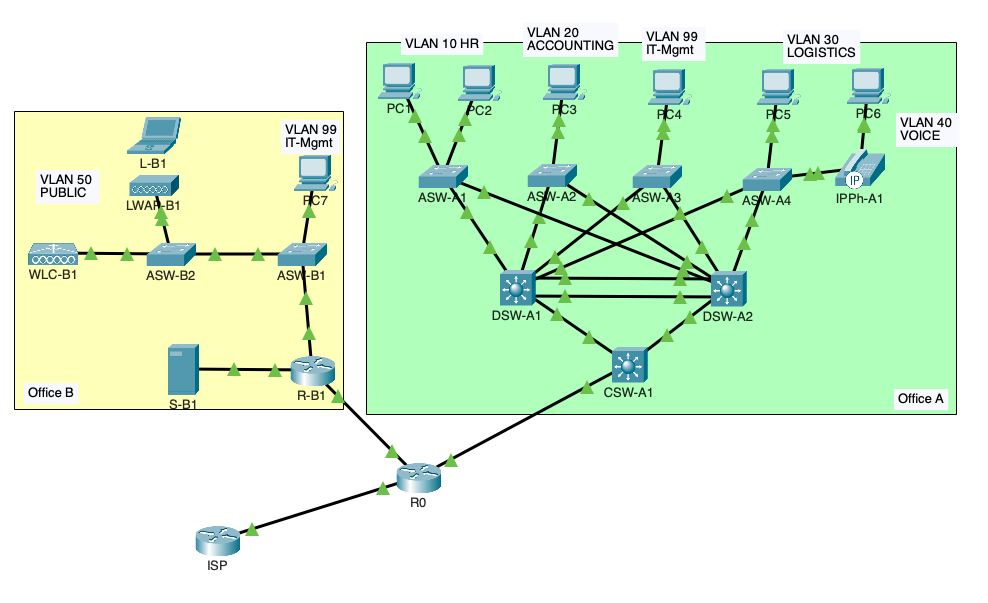

# CCNA-Lab: Campus-Netzwerk mit Hauptstandort und Branch Office

Zwei-Standort-Netzwerk in Cisco Packet Tracer, gebaut als praktische Vorbereitung auf die **CCNA 200-301 (v1.1)** und als dokumentiertes Portfolio-Projekt.
Ziel: möglichst viele CCNA-Prüfungsthemen in einem zusammenhängenden, realistischen Netz konfigurieren, verifizieren und nachvollziehbar dokumentieren.

> Packet-Tracer-Version: `<VERSION EINTRAGEN>` · Stand: `<DATUM>`

## Topologie

| Standort | Beschreibung |
|---|---|
| **Office A** (Hauptstandort) | 7 Switches (Access/Distribution), Multilayer-Switch als Layer-3-Gateway, Router0 mit Anbindung zum Internet |
| **Office B** (Branch) | Router1 (Router-on-a-Stick), 2 Switches, Wireless LAN Controller mit Access Point, Server0 (DHCP/DNS) |

## Umgesetzte CCNA-Themen

Die vollständige Zuordnung zu den offiziellen Prüfungsthemen steht in [`docs/ccna-abdeckung.md`](docs/ccna-abdeckung.md).

| Bereich | Themen im Lab |
|---|---|
| Network Access | VLANs, Voice-VLAN, Trunks, Native-VLAN, EtherChannel (LACP), Rapid PVST+, PortFast, BPDU Guard, CDP/LLDP, WLAN mit WLC |
| IP Connectivity | Inter-VLAN-Routing (SVI und Router-on-a-Stick), statische Routen, OSPFv2 (Single Area) |
| IP Services | DHCP inkl. Relay, DNS, NAT/PAT, NTP, Syslog, SSH |
| Security | Device Hardening, ACLs, Port Security, DHCP Snooping, Dynamic ARP Inspection |

## Aufbau in Phasen

| Phase | Inhalt | Status |
|---|---|---|
| [01](phases/01-basis.md) | Basiskonfiguration aller Geräte | ☐ |
| 02 | VLANs und Trunks | ☐ |
| 03 | EtherChannel und Rapid PVST+ | ☐ |
| 04 | Management-VLAN und SSH | ☐ |
| 05 | IP-Adressierung und Inter-VLAN-Routing | ☐ |
| 06 | Routing (statisch, OSPFv2) | ☐ |
| 07 | IP-Services (DHCP, DNS, NAT, NTP, Syslog) | ☐ |
| 08 | Security (ACLs, Layer-2-Security) | ☐ |
| 09 | Wireless (WLC, WLAN mit WPA2-PSK) | ☐ |
| 10 | Optional: IPv6 | ☐ |

Jede Phase folgt derselben Struktur: Ziel, Entscheidungen, Konfiguration, Verifikation, Probleme und Learnings (Vorlage: [`phases/00-vorlage.md`](phases/00-vorlage.md)).

## Dokumentation

- [`docs/ip-plan.md`](docs/ip-plan.md): Adressierung, VLANs, Subnetze
- [`docs/port-table.md`](docs/port-table.md): Verkabelung, Port für Port
- [`docs/design-decisions.md`](docs/design-decisions.md): warum das Netz so gebaut ist
- [`configs/`](configs/): finale Konfiguration pro Gerät
- [`troubleshooting/`](troubleshooting/): gezielt eingebaute Fehler mit Analyse und Lösung

## Adressierung auf einen Blick

| VLAN | Name | Subnetz | Standort |
|---|---|---|---|
| 10 | HR | 10.1.10.0/24 | A |
| 20 | ACCOUNTING | 10.1.20.0/24 | A |
| 30 | LOGISTICS | 10.1.30.0/24 | A |
| 40 | VOICE | 10.1.40.0/24 | A |
| 50 | PUBLIC | 10.2.50.0/24 | B |
| 99 | IT-MGMT | 10.1.99.0/24 und 10.2.99.0/24 | A und B |

## Bewusste Vereinfachungen

- `<z. B. Branch ohne Gateway-Redundanz: Ausfall von SW3 trennt SW7 vom Router>`
- `<z. B. zentrales DHCP auf Server0, Office A nutzt Relay über die WAN-Strecke>`

## Hinweise

- Alle Passwörter in diesem Repository sind Lab-Passwörter und im Repo durch Platzhalter ersetzt.
- Das Lab ist eine Simulation. Einzelne Befehle und Funktionen verhalten sich in Packet Tracer anders als auf echter Hardware.
