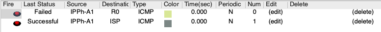

# Phase 05: Security

## Ziel
Zugriffe und Layer-2-Angriffsflächen sind eingeschränkt.

## CCNA-Bezug
5.6 ACLs, 5.7 Port Security, DHCP Snooping und DAI

## Entscheidungen
- **ACL-Aufbau:** Benannte ACLs, Whitelist (Default Deny) und möglichst wenige Listen. Extended ACLs inbound nahe der Quelle, Standard ACLs nahe dem Ziel.
- **VTY-Zugriff:** Standard-ACL `VTY-ADMIN` auf den VTY-Lines aller Router und Switches, erlaubt nur die IT-MGMT-Netze 10.1.99.0/24 und 10.2.99.0/24.
- **Abteilungen und Public-WLAN:** Je VLAN eine eigene Extended ACL, inbound auf dem Gateway-Interface der Benutzer-VLANs 10, 20, 30, 40 (DSW-A1, DSW-A2) und 50 (R-B1, Subinterface G0/1.50). Erlaubt DHCP, DNS zu S-B1 und danach nur das Internet, alles Interne (10.0.0.0/8) ist gesperrt. Dadurch sind die Abteilungen voneinander getrennt, das Public-WLAN hat nur Internetzugang und S-B1 ist auf die freigegebenen Dienste beschränkt.
- **Eine Liste pro VLAN statt einer gemeinsamen:** Die Listen sind bis auf das Quellnetz gleich. Pro VLAN ist die running-config besser nachvollziehbar, und das Quellnetz schützt zusätzlich vor gefälschten Absendern. Eine gemeinsame Liste mit Quelle `any` wäre auch möglich (siehe Learnings).
- **Ausnahme für FTP:** VLAN 20 (ACCOUNTING) darf als einziges VLAN per FTP auf S-B1 zugreifen (Dateiablage, Benutzer `cisco` im FTP-Dienst des Servers). Die Zeile steht vor der Sperre. FTP überträgt Passwörter im Klartext, im produktiven Netz wäre SFTP oder SCP üblich. Für das Lab bewusste Vereinfachung.
- **IT-MGMT bleibt ohne ACL:** Das Admin-Netz gilt als vertrauenswürdig und ist durch die VTY-ACL und die Sperren der übrigen VLANs geschützt. Das spart eine Liste und lässt NTP, Syslog und Verwaltung unberührt.
- **Kein ACL-Schutz auf dem Internet-Link:** Der Zugriff aus dem Internet auf S-B1 (statisches NAT, 203.0.113.3) bleibt bewusst offen und ist nur eine Übung (siehe Phase 04).
- **Port Security:** Auf allen Access-Ports der ASW, Maximum 1 MAC-Adresse, Violation-Modus `shutdown`. Ein abgeschalteter Port (err-disabled) wird im Packet Tracer manuell mit `shutdown` und `no shutdown` wieder aktiviert, da `errdisable recovery` dort nicht verfügbar ist. Sticky nur für feste Geräte (PC4, PC7, LWAP an ASW-B2), die übrigen Ports lernen die MAC-Adresse dynamisch, damit Geräte getauscht werden können. ASW-A4 F0/2 (IP-Phone mit PC dahinter) erlaubt 3 Adressen (siehe Learnings). Auf dem Port zum WLC gibt es keine Port Security: Der WLC bringt die Client-Frames des Public-WLANs mit den MAC-Adressen der Clients ins Netz, dort treten viele wechselnde Adressen auf.
- **DHCP Snooping:** Auf allen ASW, je Switch nur für die VLANs mit DHCP-Clients (Office B: 50 und 99). Trusted sind nur die Uplinks Richtung DSW bzw. R-B1. Alle Access-Ports und der WLC-Port bleiben Untrusted, auch im Public-WLAN: Dort verwirft das Snooping DHCP-Antworten eines Rogue-Servers. Option 82 ist abgeschaltet (`no ip dhcp snooping information option`), sonst verwirft das als Relay arbeitende DSW die Client-Pakete. Kein `limit rate` konfiguriert, gegen DHCP Starvation hilft die Port Security (Maximum 1 MAC-Adresse).
- **DAI:** Je Switch nur für die VLANs mit DHCP-Clients: ASW-A1 VLAN 10, ASW-A2 VLAN 20, ASW-A4 VLAN 30 und 40, ASW-B2 VLAN 50. Kein DAI auf ASW-A3 und ASW-B1 (dort hängen nur PC4 und PC7 mit fester Adresse in VLAN 99) und nicht auf VLAN 99, da feste Adressen nicht in der Bindungstabelle stehen und eine ARP-ACL nötig wäre. Trusted sind die Uplinks, alle Access-Ports und der WLC-Port bleiben Untrusted. Ein Rate-Limit ist im Packet Tracer nicht konfigurierbar (siehe Learnings).

## Konfiguration

_Wesentliche Auszüge, ein Gerät pro Konfigurationstyp._

#### VTY-Zugriff (alle Router und Switches)
```
ip access-list standard VTY-ADMIN
 permit 10.1.99.0 0.0.0.255
 permit 10.2.99.0 0.0.0.255
line vty 0 15
 access-class VTY-ADMIN in
```

#### Benutzer-VLANs (Beispiel VLAN 20, DSW-A1)
```
ip access-list extended ACCOUNTING
 permit udp any eq 68 any eq 67
 permit udp 10.1.20.0 0.0.0.255 host 10.2.200.10 eq domain
 permit tcp 10.1.20.0 0.0.0.255 host 10.2.200.10 eq domain
 permit tcp 10.1.20.0 0.0.0.255 host 10.2.200.10 eq ftp
 permit tcp 10.1.20.0 0.0.0.255 host 10.2.200.10 gt 1023
 deny ip 10.1.20.0 0.0.0.255 10.0.0.0 0.255.255.255
 permit icmp 10.1.20.0 0.0.0.255 any echo
 permit tcp 10.1.20.0 0.0.0.255 any eq www
 permit tcp 10.1.20.0 0.0.0.255 any eq 443
interface vlan 20
 ip access-group ACCOUNTING in
```

Die übrigen Listen sind gleich aufgebaut, ohne die beiden FTP-Zeilen und mit eigenem Quellnetz:

| VLAN | Liste | Gerät, Interface |
|---|---|---|
| 10 | `HR` | DSW-A1, `interface vlan 10` |
| 20 | `ACCOUNTING` | DSW-A1, `interface vlan 20` |
| 30 | `LOGISTICS` | DSW-A2, `interface vlan 30` |
| 40 | `VOICE` | DSW-A2, `interface vlan 40` |
| 50 | `PUBLIC_USER_IN` | R-B1, `interface g0/1.50` |

#### DHCP Snooping (ASW-B2, Auszug)
```
ip dhcp snooping vlan 50,99
no ip dhcp snooping information option
ip dhcp snooping
!
interface FastEthernet0/1
 description ##to ASW-B1##
 ip dhcp snooping trust
```
Auf den übrigen ASW gleich, mit eigener VLAN-Liste und dem Trust auf den Uplinks.

#### DAI (ASW-A1, Auszug)
```
ip arp inspection vlan 10
!
interface FastEthernet0/3
 description ##to DSW-A1##
 ip arp inspection trust
 ip dhcp snooping trust
interface FastEthernet0/4
 description ##to DSW-A2##
 ip arp inspection trust
 ip dhcp snooping trust
```
Auf den übrigen ASW gleich, mit eigener VLAN-Liste und dem Trust auf den Uplinks. DAI nutzt die Bindungstabelle des DHCP Snoopings.

## Verifikation

Stand 20.11.2026: ACLs für VLAN 10, 20, 30, 40 und `VTY-ADMIN` getestet. VLAN 50 folgt mit dem WLAN (Phase 06). Port Security auf allen Access-Ports und DHCP Snooping auf allen ASW konfiguriert. DAI konfiguriert, im Packet Tracer aber nicht nachweisbar (siehe Learnings).

| Test | Gerät | Ergebnis |
|---|---|---|
| SSH auf R0 | PC4 (VLAN 99) | möglich |
| `ssh -l ccna 203.0.113.2` (R0 am ISP-Link) | ISP-Router | `% Connection refused by remote host` (VTY-ADMIN) |
| `ftp 10.2.200.10`, `get asa842-k8.bin` | PC3 (VLAN 20) | Login und Übertragung (5571584 Bytes) |
| `ftp 10.2.200.10` | PC1 (VLAN 10) | Timeout, gesperrt |
| `ping 10.2.200.10` | PC1 | gesperrt (`Destination host unreachable` vom Gateway 10.1.10.1) |
| `ping 203.0.113.1` | PC1, PC5 | erreichbar |
| `ping 10.255.0.1` | PC5 (VLAN 30) | gesperrt |
| `ipconfig /renew` | PC1, PC5 | DHCP funktioniert trotz ACL |
| Add Simple PDU an R0 und ISP | IP-Phone (VLAN 40) | R0 Failed, ISP Successful |

IP-Phone (VLAN 40) mit Add Simple PDU:



DSW-A2, Zähler der Liste `VOICE` nach dem Ping zum R0-Loopback und danach zum ISP (die ICMP-Zeile zählt erst nach dem zweiten Ping):
```
DSW-A2#show access-lists VOICE
    40 deny ip 10.1.40.0 0.0.0.255 10.0.0.0 0.255.255.255 (32 match(es))
    50 permit icmp 10.1.40.0 0.0.0.255 any echo (1 match(es))
```

DSW-A1, Liste `ACCOUNTING` nach dem FTP-Test (Datenkanal über Zeile 45, Sperre unverändert):
```
DSW-A1#show access-lists ACCOUNTING
    40 permit tcp 10.1.20.0 0.0.0.255 host 10.2.200.10 eq ftp (47 match(es))
    45 permit tcp 10.1.20.0 0.0.0.255 host 10.2.200.10 gt 1023 (1276 match(es))
    50 deny ip 10.1.20.0 0.0.0.255 10.0.0.0 0.255.255.255 (36 match(es))
```

Port Security auf ASW-A4 F0/2 (IP-Phone mit PC), Verstoß bei Maximum 2:
```
%PM-4-ERR_DISABLE: psecure-violation error detected on Fa0/2, putting Fa0/2 in err-disable state.
%PORT_SECURITY-2-PSECURE_VIOLATION: Security violation occurred, caused by MAC address 0002.4ABE.6101 on port

ASW-A4#show port-security
Secure Port MaxSecureAddr CurrentAddr SecurityViolation Security Action
        Fa0/1        1          0                 0         Shutdown
        Fa0/2        2          2                 1         Shutdown

ASW-A4#show interfaces status
Fa0/2     ##to IPPh-A1##     err-disabled 30  auto  auto  10/100BaseTX
```
Nach `switchport port-security maximum 3` sowie `shutdown` und `no shutdown` ist der Port wieder `connected`.

ASW-A4 F0/2 mit Maximum 3 und dynamisch gelernten Adressen (nach Ping vom PC und PDU vom Phone ins Internet, Violation-Zähler 0):
```
ASW-A4#show port-security address
Vlan    Mac Address       Type                          Ports
  30    000D.BDAD.5950    DynamicConfigured             Fa0/2
  30    00D0.9766.0ADB    DynamicConfigured             Fa0/2
```

Übersicht Port Security (ein Switch je Office, Maximum 1, außer ASW-A4 F0/2 mit 3):
```
ASW-A4#show port-security
Secure Port MaxSecureAddr CurrentAddr SecurityViolation Security Action
        Fa0/1        1          1                 0         Shutdown
        Fa0/2        3          2                 0         Shutdown

ASW-B2#show port-security
Secure Port MaxSecureAddr CurrentAddr SecurityViolation Security Action
       Gig0/2        1          1                 0         Shutdown
```
Gesichert sind alle Access-Ports: ASW-A1 F0/1 und F0/2, ASW-A2 F0/3, ASW-A3 F0/1, ASW-A4 F0/1 und F0/2, ASW-B1 F0/1, ASW-B2 G0/2. Der Trunk zum WLC (ASW-B2 G0/1) hat keine Port Security.

DHCP Snooping auf ASW-B2 (Trust nur auf dem Uplink, Rate-Limit unbegrenzt):
```
ASW-B2#show ip dhcp snooping
Switch DHCP snooping is enabled
DHCP snooping is configured on following VLANs:
50,99
Insertion of option 82 is disabled
Option 82 on untrusted port is not allowed
Verification of hwaddr field is enabled
Interface                  Trusted    Rate limit (pps)
FastEthernet0/1            yes        unlimited
```

Bindungstabelle auf ASW-A4 nach `ipconfig /renew` an den PCs und einem Neustart des IP-Phones (PC6 hängt hinter dem Phone an F0/2):
```
ASW-A4#show ip dhcp snooping binding
MacAddress          IpAddress        Lease(sec)  Type           VLAN  Interface
00:D0:97:66:0A:DB   10.1.40.20       0           dhcp-snooping  30    FastEthernet0/2
00:0D:BD:AD:59:50   10.1.30.20       0           dhcp-snooping  30    FastEthernet0/2
00:0C:85:74:1C:B0   10.1.30.21       0           dhcp-snooping  30    FastEthernet0/1
Total number of bindings: 3
```

DAI auf ASW-A1 (VLAN 10 aktiv, alle Zähler bleiben auch nach Pings und `arp -d` bei 0):
```
ASW-A1#show ip arp inspection
 Vlan     Configuration    Operation   ACL Match          Static ACL
   10     Enabled          Active
 Vlan      Forwarded        Dropped     DHCP Drops      ACL Drops
   10              0              0              0              0
```

_Offen: `PUBLIC_USER_IN` auf R-B1 (nach WLAN)._

## Probleme und Learnings

- **DHCP in der ACL: Quelle und Ziel `any`, nicht der Server.** Ein Client ohne IP sendet den Discover als Broadcast (0.0.0.0:68 an 255.255.255.255:67). Eine Zeile mit `host 10.2.200.10` als Ziel trifft ihn nicht, der Client bekommt keine Adresse. Richtig: `permit udp any eq 68 any eq 67`.
- **Internetzugang in der ACL: Ziel `any`, nicht R0.** Die ACL prüft das Ziel vor dem NAT, also die echte Internetadresse. R0 G0/2 ist ein Interface und keine Zieladresse. Nach `deny ip <VLAN-Netz> 10.0.0.0 0.255.255.255` steht `any` für alles außerhalb von 10.0.0.0/8, also das Internet.
- **Reihenfolge:** Die Sperre trifft nur Ziele in 10.0.0.0/8. Internetpakete laufen daran vorbei zu den folgenden `permit`-Zeilen. Eine Ausnahme für ein internes Ziel (FTP von VLAN 20 zu S-B1) muss dagegen **vor** der Sperre stehen, sonst wird sie nie erreicht.
- **FTP braucht zwei Verbindungen.** Mit `permit tcp ... host 10.2.200.10 eq ftp` klappte nur das Login (Port 21), `dir` und `get` liefen in einen Timeout. Der Client nutzt den Passivmodus, der Server nennt dafür einen hohen Port, und die Sperre `deny ip ... 10.0.0.0/8` fing den Datenkanal ab. Der Zähler der Sperre stieg bei jedem `dir`, Port 20 (`eq 20`) hatte 0 Treffer. Lösung: `permit tcp <VLAN 20> host 10.2.200.10 gt 1023` vor der Sperre (danach 1276 Treffer, Sperre unverändert, Datei übertragen). Nachteil: Eine statische ACL öffnet damit alle hohen Ports zum Server. Eine Firewall mit Verbindungsverfolgung würde nur den benötigten Port öffnen. Die Freigabe bleibt auf ein Quellnetz und einen Zielhost begrenzt.
- **Eine Liste pro VLAN oder eine gemeinsame:** Mit Quelle `any` würde eine einzige Liste auf allen Gateway-Interfaces funktionieren, da dort nur Verkehr des jeweiligen VLANs ankommt. Gewählt wurden Listen pro VLAN (Übersicht in der running-config, Schutz vor gefälschten Absendern). Nachteil: mehr Listen mit fast gleichem Inhalt.
- **Test aus einem VLAN ohne Kommandozeile (IP-Phone, VLAN 40):** Das IP-Phone hat weder Command Prompt noch SSH-Server. Ein SSH-Versuch von PC4 auf die Phone-Adresse (per `show cdp neighbors detail` auf ASW-A4 gefunden) scheitert. Stattdessen mit dem Werkzeug **Add Simple PDU** (Briefumschlag) vom Phone zu R0 und zum ISP senden. Das Ergebnis steht im PDU-Fenster (Failed oder Successful), die Zähler von `show access-lists VOICE` bestätigen es.
- **VTY-ACL vom ISP testen:** Das Ziel muss die Adresse von R0 am ISP-Link sein (`203.0.113.2`). Die Loopback `10.255.0.1` ist für den ISP nicht routbar, der Test endet dort mit einem Timeout, ohne etwas über die ACL zu sagen. Ein Hostname (`ssh -l ccna R0`) scheitert, weil der ISP-Router nichts auflösen kann.
- **Sticky hat nichts mit der DHCP-Adresse zu tun.** Port Security prüft MAC-Adressen, ein `ipconfig /renew` ändert nur die IP. Dynamisch gelernte MACs gehen beim Neustart des Switches verloren, Sticky-MACs stehen in der running-config und bleiben nach `copy running-config startup-config`. Sticky eignet sich für feste Geräte (PC4, PC7, LWAP), dynamisch für Ports, an denen Geräte getauscht werden.
- **`errdisable recovery` gibt es im Packet Tracer nicht.** `errdisable recovery cause psecure-violation` und `errdisable recovery interval 180` werden auf den 2960 nicht angenommen. Ein err-disabled Port wird manuell mit `shutdown` und `no shutdown` reaktiviert (echtes IOS kennt beide Befehle).
- **Standardwerte stehen nicht in der running-config.** `switchport port-security maximum 1` und `violation shutdown` werden angenommen, aber nicht angezeigt, da es die Standardwerte sind. Die Einstellung prüft man mit `show port-security interface <Port>`.
- **Hinter dem IP-Phone zählt der Packet Tracer drei MAC-Adressen.** An ASW-A4 F0/2 (IP-Phone mit PC dahinter) kommen drei Quelladressen vor: die MAC des Phones selbst (VLAN-40-Interface, 00D0.9766.0ADB), die MAC des PC (PC6) und die MAC des internen Switch-Ports des Phones (0002.4ABE.6101, laut Phone-Details). Letztere tritt nur gelegentlich als Absender auf und löste die Violation aus. Bei `maximum 2` wurde der Port nach dem ersten Ping err-disabled, die Violation-Meldung nannte die dritte MAC. Mit `maximum 3` läuft der Port. Gefunden wurde es über die Meldung `PSECURE_VIOLATION` und `show port-security`. Auf echter Hardware hängen hinter einem Port mit Phone und PC üblicherweise zwei Adressen.
- **Die Adresstabelle zeigt auch die Phone-MAC mit VLAN 30.** In `show port-security address` stehen PC- und Phone-MAC beide mit VLAN 30 (dem Access-VLAN des Ports), obwohl das Phone in VLAN 40 sendet. `show port-security interface` nennt dagegen für die Phone-MAC VLAN 40 (`Last Source Address:Vlan`). Vermutlich eine Eigenheit der Packet-Tracer-Anzeige.
- **Die Lease-Spalte der Bindungstabelle steht im Packet Tracer auf 0.** Die Einträge werden trotzdem angelegt und gelten. Vermutlich eine Eigenheit der Anzeige.
- **Das IP-Phone muss nach dem Einschalten des Snoopings neu starten.** Ein Link-Wechsel (`shutdown` und `no shutdown` am Port) reichte nicht, erst das Entfernen und Einstecken des Netzteils (Reiter Physical) löste ein neues DHCP aus. Bindungen entstehen nur für Leases, die nach dem Aktivieren des Snoopings vergeben werden.
- **Die Bindungstabelle trägt für das Phone VLAN 30 statt 40 ein.** Wie bei der Port-Security-Tabelle steht das Access-VLAN des Ports, obwohl das Phone in VLAN 40 sendet (10.1.40.20). Vermutlich eine Eigenheit des Packet Tracers.
- **`ip arp inspection limit` gibt es im Packet Tracer nicht.** Am Interface steht nur `ip arp inspection trust` zur Verfügung. Das Rate-Limit (Standard 15 Pakete pro Sekunde, auf dem WLC-Port wäre `limit none` nötig) lässt sich deshalb nicht konfigurieren.
- **DAI ist im Packet Tracer nicht nachweisbar.** Die Konfiguration wird angenommen, `show ip arp inspection` zeigt das VLAN als `Enabled` und `Active`. Die Zähler bleiben aber bei 0, auch nach `arp -d` und neuen Pings, und PC2 erreicht das Gateway mit einer festen IP ohne Bindung trotzdem. Der Packet Tracer wertet ARP-Pakete offenbar nicht aus. Ein Nachweis (Dropped steigt, Log-Meldung) wäre nur auf echter Hardware möglich.
